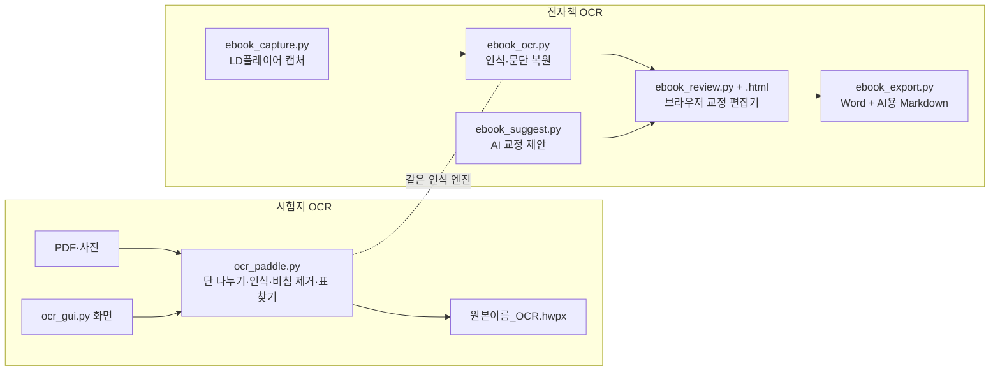

# 기술서 — 시험지 OCR · 전자책 OCR

> 포트폴리오 소개용 기술 요약입니다. 전체 명세는 저장소 맨 위 `SPEC.md`에 있습니다 (코드와 다르면 코드가 기준).
> 작업 경과는 [01_작업내역서.md](01_작업내역서.md), 사용 방법은 [03_설명서.md](03_설명서.md).

## 1. 시스템 구성



- 글자 인식 모듈 `ocr_paddle.py` 하나를 시험지 OCR의 모든 판과 전자책 OCR이 함께 씁니다.
- 사용자(코드를 다루지 않는 선생님)가 쓰는 입구는 설치 파일, 또는 번호가 붙은 배치 파일(`1_캡처점검.bat` … `6_AI교정제안.bat`)입니다.

## 2. 기술 스택

| 영역 | 사용 기술 | 고른 이유·비고 |
|---|---|---|
| 글자 인식 | PaddleOCR 3.7 (검출 PP-OCRv5 server, 인식 한국어 PP-OCRv5 mobile) | 공개 모델 그대로 사용, 재학습 없음 |
| 계산 엔진 | PaddlePaddle 3.2.2(CPU·CUDA), ONNX Runtime 1.29(저사양) | 3.3.x는 CPU에서 오류가 나서 3.2.2로 고정. AVX 없는 CPU는 ONNX로 |
| 영상 처리 | OpenCV, NumPy, pypdfium2, Pillow | 단 나누기·표 찾기·그림 판정, PDF 렌더(300dpi) |
| 문서 출력 | python-hwpx 6.8(한글), python-docx(Word) | 한글 문서가 학교 표준 |
| 한국어 처리 | kiwipiepy(Kiwi) | 줄 이음 뒤 띄어쓰기 보충 |
| 화면 | tkinter(시험지), 브라우저 + 표준 라이브러리 `http.server`(전자책 편집기) | 편집기는 외부 CDN·프레임워크 없이 HTML/JS 한 파일 |
| AI 교정 | Gemini REST(SSE), OpenAI 형식(NVIDIA build·Ollama 등) | 표준 라이브러리만으로 호출, 서비스·모델 교체 가능 |
| 배포 | PyInstaller + Inno Setup, 배치 파일 + Git | 대상 PC는 인터넷·파이썬 없이 설치 |
| 시험 | 자체 시험 스크립트, Playwright(브라우저 자동화) | OCR 엔진 없이 돌아가게 가짜 엔진·캐시 사용 |

## 3. 시험지 OCR 처리 파이프라인

해상도 기준 폭 3035px(A4 300dpi). 형태 연산 크기는 모두 `쪽 폭 / 3035`에 비례하게 잡아 해상도가 달라도 같은 결과가 나오게 했습니다.

| 단계 | 내용 |
|---|---|
| 판정용 그림 | 회색조를 배경 추정값(팽창 → 중간값 흐림)으로 나눠 종이를 흰색으로 평탄화 |
| 단 나누기 | 글줄 덩어리를 찾고, 폭 35~65% 구간에서 가로지르는 줄이 가장 적은 x를 단 경계로. 세로 구분선이 있으면 그 높이 구간만 두 단, 위 제목·아래 꼬리말은 통째 |
| 구간 인식 | 진한 잉크가 거의 없는 구간은 건너뛰고, 아주 길쭉한 띠는 흰 여백을 덧대 가로세로비 8 이내로 (엔진 오류 방지) |
| 비침 제거 | 글상자 안 잉크 중 진한(밝기 < 180) 비율이 25% 미만이면 뒷면이 비친 글로 보고 버림 |
| 표·박스 찾기 | 가로·세로 선을 형태 연산으로 뽑아 사각형 후보를 만들고, 위·아래 선 덮임 비율(한쪽 ≥ 95%, 다른 쪽 ≥ 40%)로 위가 뚫린 `<보기>` 박스까지 잡음 |
| 줄 묶기 | 세로 중심이 줄 평균과 반 글자 높이 이내면 같은 줄. 줄 안은 x 순, 넓은 간격은 탭 |
| 출력 | 박스 안 줄은 HWPX에서 칸 하나짜리 표로 감싸기만 함 (글자·읽는 순서는 표 기능과 무관하게 동일) |

**판(edition) 자동 선택과 안전장치**
- 실행 폴더에 ONNX 모델만 있으면 ONNX 엔진, 아니면 Paddle. AVX 유무는 설치 단계와 실행 단계에서 두 번 판정.
- 비정상 종료 표시 파일이 남아 있으면 다음 실행을 자동으로 안전 모드(oneDNN 끔)로.
- 경로에 한글이 있으면 Paddle이 모델을 못 여는 문제를 피하려고 공용 폴더에 한 번 복사.
- `ExamOCR.exe --check` 자가 점검(라이브러리·한글 경로 PDF·HWPX 저장·글자 인식) 결과로 빌드 성공을 판정.

## 4. 전자책 OCR 핵심 설계

### 4.1 캡처
- ADB로 쪽을 넘기고, 화면이 바뀐 뒤 멈출 때까지 기다렸다가 저장. 같은 화면이 되풀이되면 끝으로 판단.
- 전자책 앱이 스크린샷을 막으면(검은 화면) Windows 창 캡처로 자동 전환.

### 4.2 인식과 문단 복원
- 쪽별 인식 결과를 캐시(`cache/*.json`)에 저장해 중간에 멈춰도 이어 하기. 캐시가 유효한지는 판(version)·신뢰도 기준·"글자를 버리지 않은 캐시인지"로 판정합니다.
- 문단 복원: 들여쓰기, 줄 간격(1.6배), 앞 줄이 짧고 문장이 끝났는지로 문단을 나눔. 본문보다 1.3배 큰 줄은 제목, 0.75배 작은 줄은 각주.
- 교정용 글은 쪽마다 `<!-- p.N -->` 표시를 넣고, 쪽을 넘는 문단은 제 쪽에 두되 `이어짐` 표시만 해서 편집기가 쪽 단위로 보여 줄 수 있게 했습니다.
- **설계 전환 (2026-11-15)**: 처음에는 그림 영역 글자, 머리말·꼬리말을 자동으로 지웠지만, 색 표와 번호 목록을 잘못 지우는 일이 실사용에서 나와 "읽힌 글자는 모두 남기고 사람이 지운다"로 바꿨습니다. 그림 영역은 편집기에서 점선 후보로만 보여 줍니다.

### 4.3 교정 편집기 (`ebook_review.py` + `ebook_review.html`)
- 로컬 서버(`127.0.0.1`만), Host 머리글 검사(DNS rebinding 방지), 쓰기 요청은 전용 머리글 필수.
- 작업 글(`책이름_교정.md`)은 처음 한 번 만들고 OCR을 다시 돌려도 덮어쓰지 않음. 저장마다 백업 한 벌.
- 투명한 입력칸 뒤에 같은 글꼴의 `<pre>`를 깔아 마크다운을 색칠(굵기·크기는 바꾸지 않아 줄 위치가 그대로).
- 서식 버튼은 고른 글 바깥의 짝 맞는 표시(`**`, `*`, `<u>`)를 모두 읽고 하나만 켜거나 끈 뒤 같은 순서로 다시 써서, 어떤 순서로 눌러도 표시가 꼬이지 않음. 바뀐 부분만 브라우저 편집 명령으로 넣어 Ctrl+Z가 됨.
- 표 넣기: 고른 영역의 글상자를 가로로 겹치면 같은 열, 세로로 가까우면 같은 행으로 묶어 마크다운 표 초안. 글이 없는 영역은 그 영역만 잘라(여백 덧대기, 작은 영역 2배 확대) 다시 인식하고 좌표를 쪽 좌표로 되돌림. 엔진은 첫 요청 때 한 번만 준비.
- 편집기 판(`EDITOR_VERSION`)을 서버와 화면 양쪽에 두고, 업데이트 뒤 서버를 다시 켜지 않았으면 경고.

### 4.4 책 쪽 번호와 장별 내보내기
- 도구 안 쪽 번호(캡처 순번)는 절대 바꾸지 않고, 설정 파일(`책이름_장설정.json`)의 챕터 시작·쪽 번호 교정으로 책 쪽 번호를 계산합니다.
  - 캡처 c의 책 쪽 = c 이하에서 가장 가까운 설정의 `page + (c − capture)`. 앞에 설정이 없으면 `앞3`처럼 표시.
  - 뺀 쪽은 글만 빠지고 번호는 그대로 차지 → 인용 검사에서 쪽 번호가 어긋나지 않음.
- 내보낸 파일마다 제목 표시(`#`) 대신 머리 정보를 둬서 파일 하나만 떼어 써도 위치를 알 수 있게 했습니다.

```
---
책: 책이름
파트: Part 1. 도구의 이해
챕터: 1장. 도구 비교
쪽: p.8–p.15
---

[p.8]
…
```

- 장이 쪽 맨 위에서 시작하면 그 쪽 표시는 새 파일로만, 쪽 중간이면 두 파일 모두에 넣음. 챕터 시작 쪽의 챕터명과 같은 줄은 머리에만 나오게 생략.
- 결과물: `책이름.챕터01.md`, `책이름.챕터03.대주제01.md`처럼 장별 파일 + 책 전체 AI용 파일 + Word 완성본(그림 삽입, `#` → 제목 1).

### 4.5 AI 교정 제안 (`ebook_suggest.py`)
- 본문 문단만 `[id] 문단` 묶음으로 보내 고친 문단만 받음. **원문은 바꾸지 않고** 제안 파일에만 저장, 편집기에서 사람이 수락.
- 안전장치: 원문 대비 15% 넘게 바뀐 제안은 버림, 숫자·영문·서식 기호가 바뀌면 ⚠ 표시, 서식 기호는 원문대로 되돌림.
- 견고성: 조각 받기(SSE), 형식이 어긋난 답도 항목 단위로 살려 읽기, 하루 한도·서비스 종료·혼잡을 구분해 다음 모델로 넘기는 자동 모드, 거부한 설정은 모델별로 기억.

## 5. 품질 보증 방법

| 방법 | 내용 |
|---|---|
| 글자 대조 | `difflib.SequenceMatcher`로 고치기 전후 결과를 글자 단위 비교. 레이아웃 보정은 글자 차이 0일 때만 채택 |
| 판 사이 대조 | 저사양판·그래픽카드판은 일반판과 99% 이상 같아야 받아들임 |
| 골든 파일 | 설정 없는 책의 예전 내보내기 결과를 보관해 호환성 회귀 확인 |
| 브라우저 자동화 | Playwright로 편집기를 실제로 조작(목차 입력·Tab 단계·일괄 정리·글 고르기)해 기대 결과 확인 |
| 가짜 엔진 | OCR 엔진이 없는 환경에서도 영역 다시 읽기·OCR 마무리 단계를 시험하도록 엔진을 흉내 냄 |
| 재현 먼저 | 사용자 보고는 정규식·코드로 먼저 재현하고, 고치기 전 코드에서 실패하는 시험을 만든 뒤 수정 |

## 6. 운영·보안 고려

- 시험지 원본·결과는 저장소에 올리지 않음(`.gitignore`). API 키는 PC별 파일로 두고 git에서 제외.
- 편집기는 내 PC 안에서만 접속되도록 묶고, 다른 사이트가 쓰기 요청을 보내지 못하게 함.
- 파일 형식 규칙: 배치 파일은 CRLF·`chcp 65001`, 사용법은 UTF-8 BOM, 코드는 UTF-8 LF (Windows 한글 깨짐 방지).

## 7. 알려진 한계

- 사이가 좁은 나란한 박스 두 개는 표 하나로 묶임. 여러 곳이 끊긴 박스·아주 흐린 박스는 못 잡음.
- 손글씨·원문자·수식 인식, 표의 칸 구조 복원은 범위 밖.
- 전자책 내보내기의 Word·한글 표시, 실제 엔진으로의 영역 다시 읽기 품질은 현장 확인 전.
