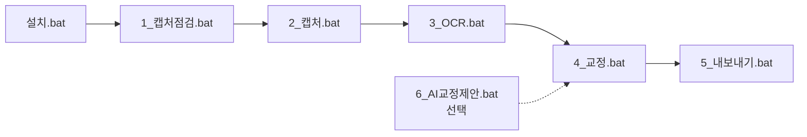

# 설명서 — 시험지 OCR · 전자책 OCR

> 포트폴리오 소개용 사용 설명입니다. 실제 사용자용 상세 안내는 `OCR/ExamOCR_build/사용법.txt`, `EbookOCR/사용법.txt`에 있습니다.
> 작업 경과는 [01_작업내역서.md](01_작업내역서.md), 기술 상세는 [02_기술서.md](02_기술서.md).

## 1. 무엇을 하는 프로그램인가

| 프로그램 | 넣는 것 | 나오는 것 | 누가 쓰나 |
|---|---|---|---|
| 시험지 OCR | 스캔한 시험지 PDF·사진 | 한글 문서 `원본이름_OCR.hwpx` | 학원 선생님 (설치 파일 실행, 버튼만 누름) |
| 전자책 OCR | 안드로이드 에뮬레이터(LD플레이어)로 연 전자책 | Word 완성본 + AI 지식 도구(NotebookLM 등)에 넣을 Markdown | 개인 학습 |

## 2. 시험지 OCR

### 2.1 설치

| 판 | 이런 PC에 | 설치 |
|---|---|---|
| 일반판 | 보통 PC (AVX 지원 CPU) | `ExamOCR_Setup.exe` 실행 → [설치] → [완료]. 바탕화면에 "시험지 OCR 변환" 아이콘 |
| 저사양판 | 오래된 PC (AVX 없는 CPU) | `ExamOCR_Lite_Setup.exe` (일반판과 함께 설치 가능) |
| 그래픽카드판 | NVIDIA 그래픽카드 PC (대량 변환) | `설치_GPU.bat` 한 번 → `GPU_실행.bat` |

설치 파일에 파이썬·라이브러리·모델이 모두 들어 있어 대상 PC에는 인터넷이 없어도 됩니다.

### 2.2 사용 순서
1. "시험지 OCR 변환"을 엽니다.
2. [파일 추가]로 시험지(PDF·사진)를 고릅니다. 여러 개 가능, 한글 경로 가능.
3. [변환 시작] → 원본과 같은 폴더에 `원본이름_OCR.hwpx`가 생깁니다. 같은 이름이 있으면 `(2)`를 붙여 고쳐 둔 파일을 덮어쓰지 않습니다.
4. "확인이 필요한 글자에 [?] 표시"를 켜 두면, 한글에서 Ctrl+F로 `[?]`를 찾아 원본과 비교해 고치면 됩니다.

### 2.3 결과의 특징
- 두 단 시험지는 왼쪽 단 → 오른쪽 단 순서로 읽습니다.
- 뒷면이 비쳐 보이는 연한 글자는 걸러냅니다.
- 테두리가 있는 표·박스(`<보기>`, 지문 등)는 한글 표 하나로 감싸 나옵니다 (칸은 나누지 않음).
- 손글씨·원문자(①~⑤)는 그대로 나오거나 깨질 수 있어 사람이 확인합니다.

## 3. 전자책 OCR

번호 순서대로 배치 파일을 두 번 누르면 됩니다.



| 단계 | 하는 일 | 결과 |
|---|---|---|
| 설치 | 파이썬 가상환경·라이브러리 설치. 교정만 하는 노트북은 `설치_교정용.bat`(OCR 엔진 없이 가볍게) | — |
| 1 캡처 점검 | LD플레이어 연결·화면 캡처가 되는지 확인 | — |
| 2 캡처 | 쪽을 넘기며 한 장씩 저장, 끝 쪽에서 자동 종료, PDF 묶음도 생성 | `page_0001.png …`, `책이름.pdf` |
| 3 OCR | 글자 인식, 문단·띄어쓰기 복원 (그래픽카드 PC는 `3_OCR_GPU.bat`) | `책이름_OCR\책이름_교정용.md` 등 |
| 4 교정 | 브라우저 편집기에서 원본과 글을 나란히 보며 고치기 (아래 3.1) | `책이름_교정.md` (자동 저장) |
| 6 AI 교정 제안 (선택) | AI가 맞춤법·오탈자 수정 **제안**만 만듦. 편집기에서 하나씩 수락/거절 | `책이름_제안.json` |
| 5 내보내기 | 사람용 Word, AI용 Markdown(책 전체 + 장별 파일) | `책이름_완성본.docx`, `책이름_AI용.md`, `책이름_AI용_나눔\` |

책 자료 폴더는 클라우드 폴더(예: Google Drive)로 지정할 수 있어, 집 PC에서 캡처·OCR하고 노트북에서 교정을 이어 할 수 있습니다. 프로그램 업데이트는 `업데이트.bat` 한 번.

### 3.1 교정 편집기에서 할 수 있는 일

| 기능 | 설명 |
|---|---|
| 나란히 보기 | 왼쪽 원본 쪽 이미지, 오른쪽 그 쪽 글. 글에서 커서를 옮기면 이미지의 해당 줄이 강조됨 |
| 서식 | 굵게·기울임·밑줄(겹쳐도 됨), 제목 `#`~`######`, 각주, 문단 위·아래 이동. 글을 고르고 제목 버튼을 누르면 고른 글만 제목 줄로 떼어 냄 |
| 그림 넣기 | 이미지에서 영역을 끌어 그림으로 넣고 설명을 적음 (AI용 글에서는 설명이 그림을 대신함). 영역 글자 다시 읽기 |
| 표 넣기 | 이미지에서 표 영역을 지정하면 칸을 나눈 표 초안. 글이 없는 영역은 그 영역만 다시 읽어 초안 생성 |
| 정리 도구 | 영역 지우기(같은 위치의 글을 여러 쪽에서 한꺼번에), 머리말·꼬리말 정리, 찾기·바꾸기 미리보기 |
| 챕터 설정 | [목차] 입력(Tab으로 단계), [챕터 시작](목차에서 고르기), [쪽 번호 교정], [이 쪽 빼기]. 쪽 이름이 "책 295P (캡처 315)"처럼 인쇄 쪽 번호로 보임 |
| 제목 구조 | 책 전체 제목을 단계별로 보고, 거르기·자동 제안으로 여러 제목의 단계를 한꺼번에 바꿈 (되돌리기 가능) |
| 진행 관리 | 쪽 확인 완료·진행률, 빠진 줄 의심 표시, 미리보기, 내보내기 전 점검표 |
| AI 제안 | 쪽별로 바뀐 곳을 표시, 고친 곳마다 골라 수락, 이 쪽/책 전체 일괄 수락(백업 후) |

### 3.2 내보낸 AI용 파일 예

챕터 설정을 해 두면 장마다 파일이 나뉘고, 각 파일은 머리 정보로 시작합니다. 글 사이의 `[p.N]`은 **책에 인쇄된 쪽 번호**라서 AI 요약의 인용을 원서와 대조할 수 있습니다.

```
---
책: 책이름
파트: Part 1. 기초
챕터: 1장 시작
쪽: p.1–p.3
---

[p.1]

[p.2]

# 1.1 개요

개요 본문이다.
```

파일 이름: `책이름.앞부분.md`, `책이름.챕터01.md`, (대주제까지 나눈 장) `책이름.챕터02.대주제01.md`.

## 4. 알아 두실 점

- OCR은 읽힌 글자를 모두 남깁니다 (그림·표·화면 캡처 속 글자, 머리말·꼬리말 포함). 필요 없는 글은 편집기에서 지웁니다.
- 교정 중인 글(`책이름_교정.md`)은 OCR을 다시 돌려도 덮어쓰지 않습니다.
- 업데이트한 뒤에는 편집기를 닫았다가 다시 켜야 합니다 (판이 다르면 경고 창).
- AI 교정 제안은 원문을 바꾸지 않습니다. 사람이 수락한 것만 글에 들어갑니다.
